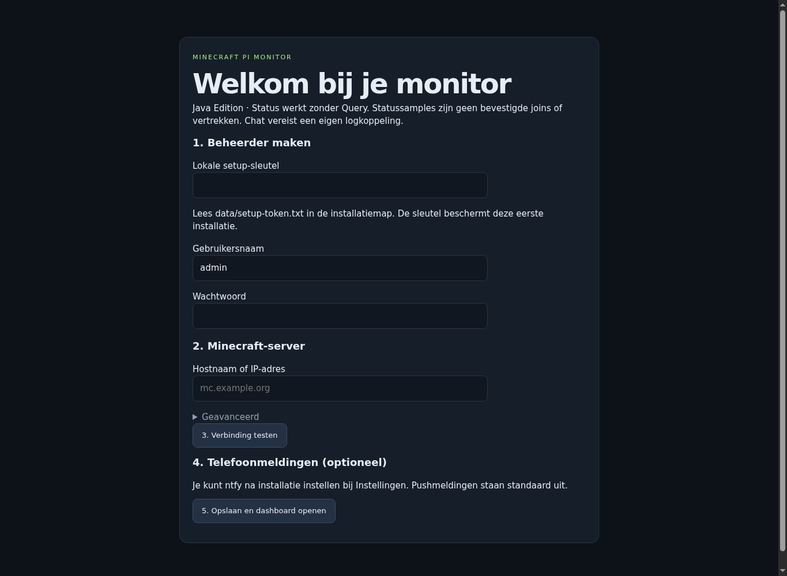
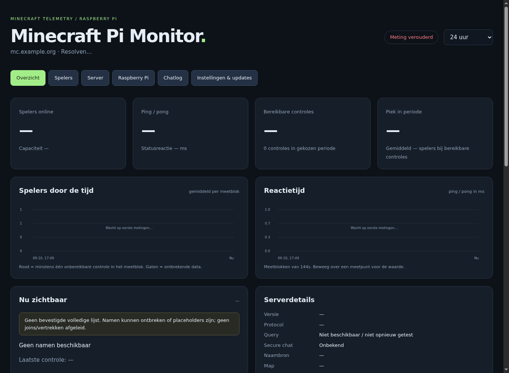
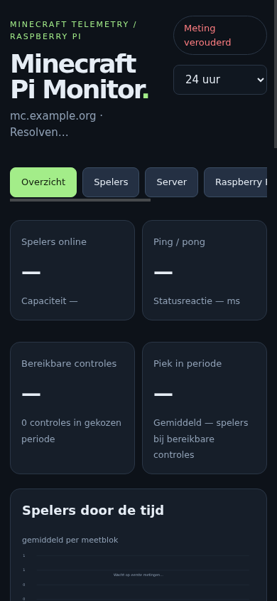

# Minecraft Pi Monitor

Een lokale, Nederlandstalige monitor voor bereikbare **Minecraft Java Edition** servers en Linux/Raspberry Pi. Geen Bedrock-ondersteuning. Python-standaardbibliotheek; geen Python-pakketten nodig. Publieke status/Query geeft geen chat, TPS, inventarissen of server-CPU/RAM.

Repository: https://github.com/djmaxbase/minecraft-pi-monitor
Releases: https://github.com/djmaxbase/minecraft-pi-monitor/releases

## Installeren

Gecontroleerd op Raspberry Pi, aarch64, Python 3.13. Python 3.9+ is de bedoelde ondergrens; andere Pi-architecturen zijn niet op hardware geverifieerd. `openssl` verifieert updates; `dig` is nodig voor SRV-resolutie. Standaard alleen toegang via vertrouwd LAN; geen routerpoorten openen. Gebruik VPN of HTTPS reverse proxy voor toegang elders. Basic-auth vereist een beveiligde verbinding buiten een vertrouwd netwerk.

Download de release-ZIP, pak uit, open de uitgepakte map en voer uit:

```sh
bash install.sh
```

De installer gebruikt sudo om Python, dnsutils en openssl te installeren en systemd te configureren. Lokale proef zonder systemd:

```sh
python3 app.py --setup
python3 app.py
```

Open `http://<pi-adres>:8080`. Lees `data/setup-token.txt` lokaal; geef deze unieke sleutel in de wizard op. Maak een beheerder (wachtwoord minimaal 12 tekens), vul een host/IP en poort in, test de verbinding en sla op. De wizard wordt gesloten. Log in met je eigen gegevens. Meldingen kun je daarna instellen. Setup-sleutels worden niet in openbare logs geschreven.

## Wat de gegevens betekenen

- Statussamples blijven **onbevestigd**, ook wanneer het aantal namen gelijk is aan het online-aantal. De server kan placeholders of een selectie publiceren.
- Een consistente Query-lijst of een expliciet lege statuslijst geldt als compleet. Verschillen tussen twee opeenvolgende complete controles kunnen aanwezigheidsovergangen vaststellen; de exacte join-/vertrektijd blijft tussen polls liggen.
- Bij een meetgat, herstart of verlies van volledigheid eindigt het sessiedeel bij de laatste volledige waarneming. Afwezigheid in een sample is nooit een vertrek.
- Sessietijd is een schatting uit meetpunten, geen exacte speeltijd. Korte sessies tussen controles zijn onzichtbaar. Historische namen/UUID's worden niet als geverifieerde identiteit samengevoegd.
- Onbereikbaar betekent onbereikbaar **vanaf deze monitor**, niet bewezen serveruitval.
- De UI gebruikt Europe/Amsterdam voor tijdstippen. Activiteitsaggregaties zijn expliciet UTC gelabeld. Opslag is UTC.

## Meldingen

Installeer ntfy op je telefoon en abonneer je op hetzelfde topic en dezelfde provider als in Instellingen. Zet de hoofdschakelaar en gewenste gebeurtenissen aan. Een geslaagde test omzeilt de hoofdschakelaar en bewijst niet dat gewone meldingen aanstaan. Provideracceptatie bewijst geen telefoonontvangst.

Zonder Query kun je **Naam verschijnt in sample (onbevestigd)** inschakelen. Dit is geen bevestigde join. Er zijn geen vertrekalerts uit onvolledige samples. Volglijst, stille uren met expliciete tijdzone, herhaalpauze en diagnose staan in Instellingen. De SQLite-wachtrij bewaart maximaal 200 berichten; ze verlopen na 24 uur. Netwerkfouten, HTTP 429 en 5xx krijgen backoff. Levering is minstens-eenmaal: na een crash tussen provideracceptatie en registratie kan een duplicaat optreden.

## Chat

Alleen gebruiken met eigen/toegestane server- of clientlogs. Een client ziet alleen chat die die client ontving. Schakel chat aan, lees de ingestiesleutel bij Instellingen en start op de computer waar `latest.log` staat:

```sh
export MONITOR_CHAT_TOKEN='de-sleutel-uit-instellingen'
python3 chat-relay.py --file /pad/naar/logs/latest.log --url http://pi-adres:8080 --source eigen-client --state relay-state.sqlite
```

Gebruik dezelfde statefile na herstart. Deze bewaart checkpoints en een begrensde outbox. `--replay` leest bestaande inhoud bij de eerste start. Retries behouden ids; twee dezelfde regels op verschillende posities blijven aparte berichten. Rotatie en verkorting worden gedetecteerd. Niet-gelezen inhoud in een reeds vervangen log kan verloren gaan: bewaar oude logs voor import. Tijdzone en datum uit eenvoudige logregels zijn onbekend; ingestietijd blijft apart. `<speler> tekst` en `[CHAT]` worden ondersteund; andere formaten worden overgeslagen. De sleutel kan uitsluitend chat toevoegen.

## Serverprofielen

Eén actief gemonitord profiel per installatie. Een ander adres via Instellingen maakt een nieuwe server-id en herstart de collector. Oude historie blijft in SQLite; de actieve weergaven en exports zijn gescheiden per server. Gelijktijdige monitoring en een selector voor oude profielen zijn nog niet beschikbaar. Verander daarom geen serveradressen rechtstreeks in SQL.

## Updates en herstel

Zie [RECOVERY.md](RECOVERY.md). GitHub-updates: Instellingen → GitHub Releases → Controleren → release-opmerkingen lezen → Installeren. Handmatige ZIP blijft beschikbaar voor vertrouwde offline pakketten. Automatische installatie is een aparte opt-in instelling en staat standaard uit. Een meegeleverde checksum bewijst geen authenticiteit: GitHub-installatie vereist de RSA/SHA-256-handtekening en de ingebouwde publieke sleutel.

## Ontwikkelen en architectuur

`app.py`: HTTP, collector en opslag. `observe.py`: observaties en sessiegrenzen. `schema.py`: migraties. `insights.py`: aggregaten. `settings.py`: authenticatie en persistente meldingen. `telemetry.py`: Linux-sensoren. `chatlogs.py`/`chat-relay.py`: bevoegde logingestie. `updater.py` en de aparte `launcher.py`: staging en codeherstel. Eén proces met threads, SQLite WAL, begrensde exports en wachtrijen.

```sh
python3 -m unittest discover -s tests -v
python3 make_release.py
```

Geen derde-partij Python-code, JS-bibliotheken, fonts of grafische assets gebundeld. Eigen code: MIT. Python, OpenSSL en dnsutils worden door het OS geleverd onder hun eigen licenties. Een release bevat uitsluitend expliciet toegestane bronbestanden en documentatie, nooit runtimegegevens.

## Bekende grenzen van 2.1.1

Geen gegarandeerde chatvolledigheid, exacte speeltijd, geverifieerde naamhistorie of gelijktijdige multi-servercollectie. Geen hardwareclaim voor armv7/x86 of andere Python-versies zonder CI/hardwarebewijs. De systemd-installatie vereist sudo. Browsercontrole en screenshots staan afzonderlijk in het verificatieverslag; geen mockups als werkende UI voorstellen. Zie CHANGELOG.md voor deze upgrade.

## Werkelijke interface

Screenshots van een geïsoleerde verse installatie, zonder verzonnen meetgegevens:




